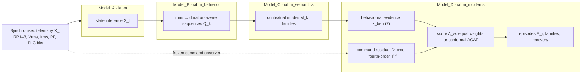

# Multi-Scale Operational Evidence

**Calibrated, certified and auditable incident evidence from low-intrusion industrial telemetry.**

This repository implements a hierarchical framework that turns the telemetry
an industrial asset already produces (one-second three-phase electrical
measurements plus PLC digital states) into multi-scale evidence of how
operational disturbances develop, persist and recover, without dedicated
condition-monitoring sensors or exhaustive failure labels. It accompanies the
manuscript

> A. Bello-García, J. Villalba-Díez, A. González-Marcos, J. Ordieres-Meré.
> *Calibrated Multi-Scale Incident Evidence from Low-Intrusion Electrical Telemetry with Certified Fourth-Order Transient Analysis.* Submitted to *Results in Engineering*, 2026.

and is demonstrated on an unattended wheel-washing facility monitored from
2022 to 2026.

---

## What is new

| Contribution | Where | Key result on the industrial case |
|---|---|---|
| Fourth-order transient operator read as a **FOBI kurtosis matrix** and a **three-qubit residual density operator** (magnitude vs shape) | `iabm_incidents.quantum`, `iabm_incidents.electrical` | Transient evidence is carried by multivariate kurtosis (Spearman 0.99 with T⁽⁴⁾) |
| **Certified VQE**: rigorous Kato–Temple bounds with a measurable Frobenius gap | `iabm_incidents.quantum.kato_temple_bounds` | Long-window decisions certified without the exact eigensolver; only 39.5 % of 15-min transient-only decisions certified, the rest routed to exact computation; no certified error |
| **NISQ resource model**: Pauli/qubit-wise-commuting measurement, finite shots, depolarising and readout noise, shot-based noisy VQE | `ShotEstimator`, `NoisyVQEDirectionSolver` | 24-h decisions unchanged at 64 shots per basis; at 15 min, few shots and unmitigated noise change 1–3 % of transient-only decisions |
| **Conformal Cauchy-combination fusion** of evidence dimensions and integration scales with attribution | `iabm_incidents.conformal` | Physical evidence becomes decision-relevant; scale dependence becomes monotone |
| **Semi-synthetic fault injection** through the frozen observer (labelled ground truth) | `iabm_incidents.injection` | Fourth order flags 98 % of one-hour windows with ~6 one-second dropouts (75 % at 2/h) vs 34 % (26 %) for 2nd order and 9 % for the mean residual |
| **Shape-operator identification**: Pauli signature of the change of the residual density operator | `iabm_incidents.identification`, `window_shape_signature` | Single- vs three-phase under-response: macro-F1 0.59 → 0.83; fault family 0.76 → 0.82 |
| Matched **M0–M3 ablation**, **multiscale sensitivity**, class-level Model A diagnostics | `iabm_incidents.ablation`, `iabm_incidents.multiscale` | Reproducible artifacts under `reports/` |

---

## Architecture



| Layer | Package | Folder | Responsibility |
|---|---|---|---|
| Model A | `iabm` | `src/Model_A` | Operational-state inference (Random Forest / XGBoost) |
| Model B | `iabm_behavior` | `src/Model_B` | State runs, duration-aware sequences, nominal comparison |
| Model C | `iabm_semantics` | `src/Model_C` | Operating/working modes, incident-family semantics |
| Model D | `iabm_incidents` | `src/Model_D` | Evidence vectors, electrical/fourth-order evidence, exact/VQE solvers, certificates, conformal fusion, episodes, ablation, multiscale, injection |

Each package has its own README with installation, CLI and API details.

---

## Repository layout

```text
multiscale-operational-evidence/
├── data/               raw telemetry (Git LFS; see data/README.md)
├── docs/               Sphinx documentation sources
├── ontology/           OWL/Turtle schema, instance examples and SPARQL queries
├── reports/
│   ├── four_level_ablation/   M0–M3 ablation and multiscale sensitivity outputs
│   └── extensions/            certification, noise, injection and fusion outputs
└── src/
    ├── Model_A/ … Model_D/    installable packages with tests
    ├── predictions/           derived artifacts (small summaries versioned)
    └── *.py                   batch and experiment drivers
```

`*.csv`, `*.parquet` and `*.npz` files are stored with **Git LFS**.

---

## Installation

```bash
git lfs install
git clone https://github.com/Ind50-UPM/multiscale-operational-evidence.git
cd multiscale-operational-evidence
python -m venv .venv && source .venv/bin/activate
pip install -e src/Model_A -e src/Model_B -e src/Model_C -e "src/Model_D[experiments]"
```

Validated with Python 3.12, NumPy 2.2, pandas 3.0, pyarrow 17 and
scikit-learn 1.5. Each package can also be installed with Poetry from its folder.

## Tests

```bash
for pkg in Model_A Model_B Model_C Model_D; do (cd src/$pkg && python -m pytest -q tests); done
```

## Reproducing the manuscript

The raw telemetry is versioned under `data/` with Git LFS (see `data/README.md`).
Derived artifacts that the experiments consume are already versioned.

```bash
export PYTHONPATH=src:src/Model_D
python src/run_model_d_ablation.py                 # M0–M3 ablation, 24-h windows
python src/run_model_d_multiscale.py               # 15 min / 1 h / 6 h / 24 h sensitivity
python src/run_model_d_extensions.py --stage all   # Model A metrics, certificates, noise, injection, fusion, identification
python src/export_extension_figure_data.py         # pgfplots tables used in the paper figures
```

The `quantum` and `fusion` stages run from versioned artifacts only; the
`telemetry` stage (fault injection and second-order statistics) needs the raw
Parquet files. Every experiment runner verifies by SHA-256 hashing that the
read-only primary artifacts are unchanged. See `docs/reproducibility.rst` and
`docs/paper_map.rst` for the full mapping from manuscript sections to code and
outputs.

## Documentation

```bash
pip install -r docs/requirements.txt     # Graphviz is needed for UML diagrams
sphinx-build -b html docs docs/_build/html
```

The site contains concept guides, package guides, experiment protocols and
results, Mermaid and Graphviz UML diagrams, a development guide, and a
recursive API reference generated from Google-style docstrings. CI publishes
it to GitHub Pages on every push to `main`.

## Scope and limitations

The framework characterises operational evidence; it does not claim physical
failure prognostics, a quantum advantage (the 8×8 operator is trivial
classically; the contribution is the certified, resource-accounted
evaluation), or cross-asset generalisation from a single installation.
Weak automatically derived references are dense, so overlap with them is
reported together with its lift over warning burden; labelled injections
provide the decisive comparisons.

## Citation

See [`CITATION.cff`](CITATION.cff).

## License

GNU Affero General Public License v3.0; see [`LICENSE`](LICENSE).
