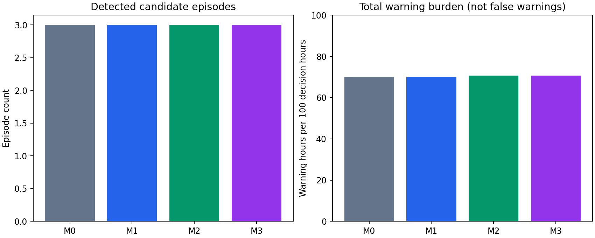
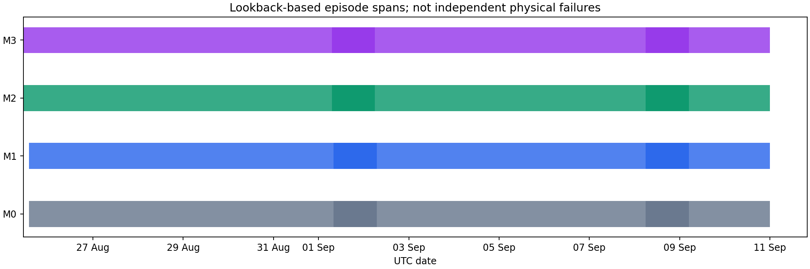
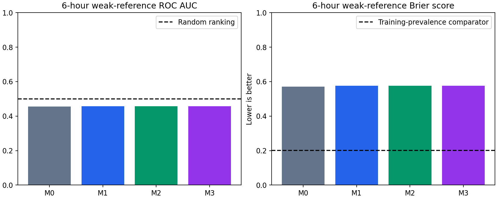

Focused M0--M3 ablation results
===============================

Executed comparison and conclusion
----------------------------------

The four-level real-data comparison was executed using the protocol in
:doc:`model_d_ablation`. The dataset covers 1 July--10 September 2022 and the
held-out windows cover 19 August--10 September. Dates and decision availability
are UTC. The newly fitted stages are chronological; the original fit provenance
of retained Model A predictions is not reconstructed.

The defensible conclusion is limited: command residual evidence changes score
magnitudes but not decisions at this operating point; exact fourth-order
evidence adds three warning windows and shifts the first candidate onset;
VQE adds no warning or episode relative to the identical-matrix exact solver.
The risk layer does not outperform a constant-prevalence comparator. These
results do not demonstrate improved physical-fault detection or a quantum
advantage.

The historical saved baseline was a semantic route. M0 here is the disclosed
new raw-command implementation of all seven behavioral dimensions, including a
command-activity mode proxy. It must not be presented as numerical replay of the
paper's saved semantic baseline or a complete retraining of Models A--C.

Support and calibration
-----------------------

The original files provide 7,712,604 electrical observations and 12,358,892 digital
observations within the focused interval. The observed median cadence is
0.807 s. Causal alignment leaves eight unmatched command samples. Those remain
masked; their transitions are not connected across the unknown observation.
Rare unseen states retain sequence/occupancy evidence, while supported-state
dwell statistics expose their nominal support fraction.

There are 313 matched reference windows,
282 matched calibration windows and
529 matched held-out windows. Thirty-one calibration
windows lack sufficient electrical reference support; no held-out window is
removed by the final common-support policy. Forty-six windows straddle a
partition boundary and are excluded. The 529 held-out decisions represent
528 observed decision hours after end-of-study truncation, not 529 independent
days or 529 nonoverlapping 24-hour observations.

The retained Model A predictions match 16.43% of all focused electrical samples;
median held-out-window prediction coverage is
13.85%. State disagreement is computed
on available exact timestamp matches, not by treating missing predictions as
correct. This shared upstream input and its unknown original fit split limit
claims about temporal validation of the complete architecture.

M0, M1 and M2 flag approximately 5.32% of calibration windows. M3 flags 4.96%
under the common exact threshold. These are observed warning fractions under a
reference-candidate calibration protocol, not measured false-positive rates.
The much larger held-out warning burden indicates marked distribution shift or
insufficient calibration transfer; without health adjudication it cannot be
assigned to either genuine failures or false alarms.

Episode detection and warning burden
------------------------------------

.. csv-table:: Matched held-out comparison
   :file: _static/ablation/summary.csv
   :header-rows: 1

M0 and M1 agree on all 529 warning decisions. M2/M3 retain all 371 M0/M1 warnings
and add three warning windows: agreement with M0/M1 is 99.43%. All levels produce
three candidate episodes. Thus the added transient evidence changes boundaries
and evidence strength, not the number of detected physical failures.

M3 is calibrated with M2's exact coordinate scale and threshold. The auxiliary
independently calibrated threshold gives the same 374 test warnings here.
Identical decisions do not imply identical numerical scores or projections.
Warning burden is a workload measure; independent false-warning burden is
unavailable.

Fragmentation, onset, family evidence and recovery
--------------------------------------------------

The first M0/M1 candidate starts at 25 August 14:00, with its two-window onset
confirmation available at 26 August 15:00. M2/M3 move these times to 25 August
11:00 and 26 August 12:00. This is a three-hour difference in decision
availability at the chosen calibrated operating point. It is not independently
validated anticipation of a physical failure, and the first lookback-window
start is not the alarm availability time.

The remaining splits largely reflect the existing duration-based segmentation
of a prolonged warning regime. Two of the three lookback spans in every level
exceed the configured seven-day target, because the inherited valley-based
splitter does not enforce a strict bound on lookback span. This limitation is
explicitly audited rather than hidden. Candidate fragmentation must not be
presented as separate physical failures or a proven fragmentation improvement.

Against 377 **fixed derived signal records**, temporal event overlap rises from
71.35% for M0/M1 to 72.15% for M2/M3 (269 versus 272 records). Episodes per hit
record change from 1.1190 to 1.1176; excess episode/reference overlaps remain 32
for all levels. One episode can cover multiple point references, so these are
not independent failure counts. The small change does not establish physical
fragmentation improvement.

All three episodes retain the existing classifier's ``pump_abrupt_failure``
label in every level. Weak-reference family agreement is 66.91% for M0/M1 and
67.28% for M2/M3. These labels and their agreement with a derived registry are
not expert confirmation. Raw behavioral, command and fourth-order episode
features are exported separately so the larger evidence magnitudes can be
reviewed without inventing new physical families.

No level observes threshold-confirmed stable recovery before the available
block/study end. Median recovery time is unavailable, not zero. The registry
contains no independent recovery timestamps, so physical recovery accuracy
cannot be evaluated.

VQE approximation and retrospective localization
------------------------------------------------

The study solves 8,416 supported state/window operators with an equal VQE
budget. Exact and VQE scores use identical symmetric eight-dimensional matrices.
Across the 529 matched held-out windows, relative **fourth-root score** deficit
has median 0.1341%, 95th percentile
0.1831% and maximum 0.6704%.
M2 and M3 agree on all 529 decisions and all three episode boundaries. No
VQE-only warning is observed.

However, equivalent decisions do not certify equivalent explanations. For
retrospective projection peaks in all matched windows, median absolute
exact/VQE timestamp displacement is
0.000 s,
but its 95th percentile is
12203.085 s
(3.39 h).
Within the 374 warning windows, the 95th percentile is 20565.943 s
(5.71 h).

These are maxima inside 24-hour completed windows. Small direction changes can
select a different among several competing peaks. The result supports neither
unique impulse localization nor physical-onset accuracy. The exact
solver-independent direction remains the default post hoc interpretation;
near-tied directions and competing peaks need explicit review. Approximate
score fidelity alone is not a localization certificate.

Risk model performance
----------------------

All levels use the same fixed future derived-event targets, with horizon purge
and right censoring. None uses its own episodes as ground truth. Six-hour
training uses 282 windows; held-out evaluation uses 523 windows. The training
positive rate is 81.56%, and the held-out rate is 73.61%.

.. csv-table:: Six-hour weak-reference risk prediction
   :file: _static/ablation/risk_6h.csv
   :header-rows: 1

All ROC AUC values are below 0.5. All Brier scores, approximately 0.572--0.577,
are substantially worse than the constant training-prevalence predictor's
0.201. Small F1 changes do not overcome this negative ranking/calibration
result. The existing risk model is not supported for operational risk
probabilities by this experiment; adding command or transient coordinates does
not rescue its held-out performance.

At 24, 72 and 168 hours, every training and test target is positive. The
corresponding censored test sets have 505, 457 and 361 rows. Their perfect
precision/recall and tiny Brier values are trivial constant-target results;
ROC AUC is undefined. These horizons cannot distinguish risk. Dense weak
incident generation makes this target unsuitable for validating a physical
failure forecasting model.

Maintenance and independent-label limits
----------------------------------------

The full repository search located a retained 2024--2026 maintenance comparison
with 14 intervention periods and 11 work-order points. Its referenced Word
sources are absent, and the retained aggregate counts contain no recoverable
interval-level truth. Their dates do not overlap this focused 2022 study.
Consequently the old 14/14 maintenance match is not reused for M0--M3.

Independent maintenance overlap, false-warning burden, physical-onset accuracy,
physical recovery accuracy and physical-failure risk performance are explicitly
unavailable. The automatically derived registry supplies exploratory signal
references only. No unmatched episode becomes a false warning merely because
it is absent from that incomplete registry.

Assessment for the paper
------------------------

The current evidence supports a narrowly qualified statement: the classical
fourth-order channel adds a small amount of temporal warning evidence to the
matched behavioral/command route, while a fixed-budget VQE approximation
reproduces the exact solver's decisions. It does not establish improved
physical-fault detection, fewer false warnings, maintenance effectiveness,
robust impulse localization or useful calibrated failure risk. A uniquely
quantum detection or forecasting benefit is not demonstrated.

Preserve the exact fourth-order definition as the scientific indicator and
position VQE as an auditable approximation. Keep the frequency-response layer
post hoc. Before broader validation, recover temporally aligned reported
interventions and independent health/onset/recovery records, validate observer
adequacy and the upstream Model A time split, and redesign risk targets around
adjudicated outcomes with both positive and negative support. The observed
warning-distribution shift and inherited duration-splitting limitation also
need resolution before operational deployment.

Artifacts and reproducibility
-----------------------------

All outputs are under ``reports/four_level_ablation/2022_focused``. The English
``ablation_report.html`` and ``assessment.md`` give the executed comparison;
CSV tables, full per-level scores/episodes, risk coefficients and predictions,
raw indicators, exact/VQE peak timestamps, stored operators/directions,
reference-source audit, source hashes and environment versions support review.
The figures and concise tables on this page are snapshots of those artifacts.
Rerun using the commands in :doc:`model_d_ablation`; the report itself
contains no generated health labels or synthetic equipment observations.
