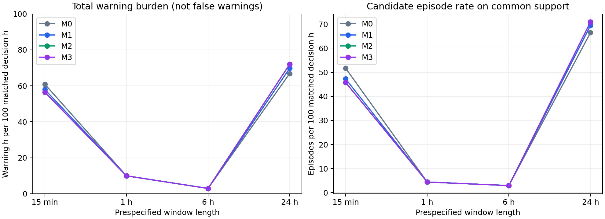

Executed multiscale sensitivity results
=======================================

Scope and retained primary experiment
-------------------------------------

The single prespecified 15-minute/1-hour/6-hour/24-hour sensitivity was executed
on real observations from the same focused 2022 study. The original 24-hour,
hourly-updated experiment and all 41 of its artifact files remain byte-for-byte
unchanged, verified by SHA-256 before and after execution.

This supplemental experiment uses one common 15-minute decision grid. Its
24-hour arm therefore differs from the primary study in update cadence and
matched cohort; its episode count must not be substituted into the primary
results. Only the window length differs between sensitivity arms. Frozen
command/electrical references, VQE budget, phase boundaries, score-calibration
rules, family classifier, segmentation policy and risk horizons are held fixed.
The full protocol is in :doc:`model_d_multiscale`.

Common support dominates the interpretation
-------------------------------------------

The four arms have 2,113 candidate held-out endpoints, corresponding to the
shared widest-window warmup and phase eligibility. Own support rises strongly
with window length:

.. csv-table:: Held-out availability
   :file: _static/multiscale/availability.csv
   :header-rows: 1

The strict four-scale/four-level intersection retains **271 held-out decisions**
(12.83% of candidate endpoints), representing **67.75 matched decision hours**.
It retains 329 reference endpoints and
192 calibration endpoints. Every
M0--M3/scale comparison uses these same rows and exposure denominators.

The 15-minute arm often lacks 32 retained Model A predictions or enough safe,
reference-supported delayed vectors. Support requirements are not reduced and
missing dimensions are not replaced with zero. The resulting cohort is
concentrated around supported active command regimes. It is not representative
of uninterrupted calendar exposure, the original 528 decision-hour primary
cohort, or each scale's own maximum availability.

Unsupported endpoints break segmentation/recovery blocks at every scale. This
can fragment long overlapping lookbacks into numerous short candidate blocks;
those fragments are not separate physical failures. The matched support audit
must accompany every numerical comparison.

Detection and total warning burden
----------------------------------

.. csv-table:: One sensitivity, four scales and four evidence levels
   :file: _static/multiscale/summary.csv
   :header-rows: 1

The result is strongly window-dependent and non-monotonic. For M2/M3, warning
burden is 56.46%, 9.96%, 2.95% and 71.96% of matched decision exposure at 15 min,
1 h, 6 h and 24 h respectively. Candidate counts are 31, 3, 2 and 48.
The low burden at 1/6 h does not establish better fault detection or fewer false
warnings: independent health adjudication is unavailable and weak-reference
capture also falls substantially.

At 15 min, M1/M2 flag fewer windows than M0 after each level's prescribed
nominal calibration. Adding a nonnegative coordinate increases a raw composite
score but does not force monotonically increasing decisions when thresholds
are recalibrated. At 24 h, added command/transient evidence instead increases
warning count. Thus the direction of the nested-evidence effect is not robust
to integration interval at these operating points.

No held-out result chooses a preferred scale or changes a threshold, mask,
circuit budget or model. The four prespecified outcomes remain reported,
including the high short- and long-window warning burdens.

Weak-reference fragmentation, onset and family evidence
-------------------------------------------------------

Retrospective comparison uses **115 fixed derived signal records** whose event
timestamps fall within common-supported 15-minute test observations. Longer
lookbacks cannot enlarge this denominator. Forecast targets retain the entire
original future-event registry, including events outside those predictor
support intervals.

For M2/M3, episode overlap with those 115 records is 44.35%, 3.48%, 6.96% and
73.04% at 15 min, 1 h, 6 h and 24 h. These are post hoc temporal overlaps with
weak records, not independent physical-fault recall. Wider lookbacks can
increase overlap by construction and do not prove timely alarms.

Mean candidate episodes per hit record for M2/M3 are 1.2353, 1.0000, 1.3750 and
4.1071. The high 24-hour overlap/fragmentation reflects broad lookbacks and
support-block fragmentation. The two 6-hour candidates overlap fewer records;
that is not sufficient evidence to rank the window as operationally best.

Per-arm episode tables preserve onset-confirmation availability timestamps,
raw evidence features, existing family labels, score recovery and censoring.
No arm/level confirms stable score recovery before its available support block
ends. Physical onset, family correctness and physical recovery accuracy remain
unvalidated. The previously disclosed Model A fit provenance and sparse
prediction coverage are unchanged upstream limitations.

Exact and VQE decisions versus explanation
------------------------------------------

All arms use identical exact/VQE operator pairs and the original three-layer,
six-sweep, two-restart circuit budget. In total, 62,502 supported context
operators are retained, including cases outside the final cross-scale cohort.
There is no exact eigenvector warm start, exact fallback or favourable-case
filtering.

M2 and M3 agree on all 271 matched held-out warning decisions at every scale.
No VQE-only warning, additional episode or demonstrated detection advantage
appears at any prespecified integration interval. Independently calibrated
threshold diagnostics are retained separately from the primary common
exact/VQE threshold comparison.

.. csv-table:: Detection agreement and retrospective projection consistency
   :file: _static/multiscale/solver_agreement.csv
   :header-rows: 1

Peak-location tails remain substantial. The 15-minute arm's median exact/VQE
peak displacement is one nominal sample (0.807 s), but its 95th percentile is
613.823 s, approximately 10.23 min. At 1, 6 and 24 h the 95th percentiles are
1,423.537 s, 8,752.771 s and 12,203.085 s. These are maxima inside completed
windows, not independently known physical-onset errors. A shorter integration
interval bounds the search region but does not certify a unique impulse or
reliable early warning. Identical decisions do not certify identical
explanations.

Risk model performance
----------------------

The forecast comparison uses identical future labels at identical predictor
endpoints and a fixed 19 August horizon-purge boundary at all scales. Six-hour
risk fitting uses 192 calibration rows and evaluation uses 268 held-out rows
with complete horizons. Held-out target prevalence is 82.46%.

.. csv-table:: Six-hour prediction of the fixed weak event process
   :file: _static/multiscale/risk_6h.csv
   :header-rows: 1

Every six-hour Brier score is worse than the constant training-prevalence
predictor's 0.1586. The 6-hour-window M0 arm has a moderate ROC AUC of 0.6010,
but its Brier score of 0.1668 still fails to improve that calibration comparator.
The 15-minute M0 arm is similarly close, at 0.1663. The other added-evidence
models can be materially worse. These point estimates do not establish
statistically significant ranking differences or useful calibrated physical
risk prediction.

At 15 min, M2/M3 detection decisions are identical but their forecast Brier
scores differ (0.3032 versus 0.3247), illustrating that indicator approximation
and downstream fitted probabilities need their own audit. A matching warning
set does not guarantee an unchanged forecast distribution.

The 24-, 72- and 168-hour targets remain all positive on the available complete
training/test horizons. Their perfect precision/recall and undefined ROC AUC
are single-class artefacts, not successful discrimination. All outcomes are
fixed automatically derived records, not each model's own detected episodes
and not independent physical-failure labels.

Assessment and validation limits
--------------------------------

This sensitivity supports three qualified conclusions:

* integration interval materially affects candidate warning behaviour;
* VQE still does not add detection coverage over the identical exact operator;
* shortened windows do not resolve sparse support, localization ambiguity,
  weak-label target degeneracy or risk calibration failure.

It does not establish that 6 h, 1 h or any other window is the preferred
operational scale. The apparent low-workload arms capture fewer weak records,
and the common cohort covers only a small fraction of the scheduled decision
exposure. Independent false-warning burden, maintenance overlap and physical
onset/recovery/risk validation remain unavailable in this 2022 study. The
repository's retained 2024--2026 maintenance comparison is not reused as truth.

For the paper, retain the primary 24-hour/hourly experiment and present this
as **one supplemental, prespecified multiscale sensitivity**, with its common
support table and the limitations above. Keep the exact fourth-order definition
as the scientific indicator and the frequency-response layer post hoc. Report
all four scales rather than claiming a tuned optimum from these results.

Artifacts and reproducibility
-----------------------------

The English ``sensitivity_report.html`` and ``assessment.md`` are under
``reports/four_level_ablation/multiscale_sensitivity``. Aggregate/per-arm CSV
outputs, raw scale-specific indicators, all operator/direction pairs, risk
predictions and coefficients, source hashes, support audit and the 41-file
primary integrity manifest remain available there. The figure and concise
tables on this page are snapshots of the executed results.

Run or re-evaluate using :doc:`model_d_multiscale`. Cache reuse verifies the
same frozen observer/reference, window grid and circuit budget. The primary
experiment's defaults, result tables and report are preserved.
