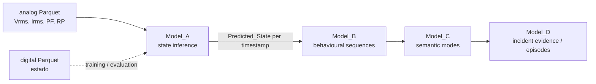
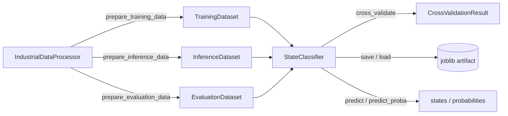

# Model_A: Industrial State Identification (`iabm`)

`Model_A` is the first stage of the multi-scale operational-evidence framework for low-intrusion industrial telemetry. It performs **supervised operating-state identification**: analog electrical variables (per-phase RMS voltage, RMS current, power factor and active power) are mapped to a discrete operating-state code per timestamp. Labels are learned from a digital state stream (column `estado`) that is required only for training and evaluation; inference uses analog data alone.

The installable package is named `iabm` (*Industrial Asset Behavioral Monitoring*). It provides a CLI (`industrial-id`) and a small object-oriented Python API.

## Position in the pipeline



Internally:



## Scope

- analog and digital Parquet input datasets
- legacy-compatible NaN imputation for three-phase electrical signals
- activity filtering with an active-power threshold
- supervised labelling of active analog rows from the previous non-zero digital state
- Random Forest (`rf`) and XGBoost (`xgb`) classifiers
- (stratified) K-fold cross-validation with per-fold scaling
- model persistence including scaler, label encoder, hyperparameters and feature order
- prediction on new analog data without digital labels
- evaluation of one or more saved models (accuracy, confusion matrices, one-vs-rest ROC AUC, plots)
- English and Spanish CLI messages read directly from `.po` catalogs

## Package layout

```text
src/Model_A/
├── iabm/
│   ├── __init__.py        # public API re-exports
│   ├── data_processor.py  # loading, imputation, activity mask, label transfer
│   ├── models.py          # StateClassifier, CrossValidationResult, CV helpers
│   ├── main.py            # CLI (industrial-id) and evaluation/report helpers
│   └── utils.py           # setup_i18n: .po-based translations
├── locales/{en,es}/LC_MESSAGES/messages.po
├── tests/                 # pytest suite (synthetic data)
├── pyproject.toml
├── pytest.ini
└── README.md
```

## Installation

Requirements (from `pyproject.toml`): Python `^3.10`, `numpy`, `pandas`, `scikit-learn`, `xgboost`, `pyarrow`, `joblib`, `matplotlib`, `scipy`, `openpyxl`. Development group: `pytest`, `sphinx`, `black`.

With Poetry (recommended; uses `poetry.lock`):

```bash
cd src/Model_A
poetry install            # installs runtime + dev dependencies
poetry run industrial-id --help
```

With pip (editable install, built by `poetry-core`):

```bash
cd src/Model_A
pip install -e .
industrial-id --help
```

The CLI can also be run as a module from `src/Model_A`:

```bash
python -m iabm.main --help
```

Note: importing `iabm` imports `xgboost`, so it must be installed even if only Random Forest is used.

## Command-line usage

```text
industrial-id --mode {train,predict,evaluate} --start "YYYY-MM-DD HH:MM:SS" --end "YYYY-MM-DD HH:MM:SS" [options]
```

| Option | Default | Meaning |
|---|---|---|
| `--mode {train,predict,evaluate}` | required | Workflow to run. |
| `--start`, `--end` | required | Inclusive time window, compared against the Parquet index. |
| `--algo {rf,xgb}` | `rf` | Algorithm to train; also selects the default artifact name. |
| `--lang {es,en}` | `en` | Interface language (use the `--lang es` form; `--lang=es` is not detected for translations). |
| `--data-ana` / `--data_ana` | `data/analogicas_nonans.parquet` | Analog Parquet input. |
| `--data-dig` / `--data_dig` | `data/digitales.parquet` | Digital Parquet input (labels). |
| `--model-out` / `--model_out` | `src/models/Model_A/<analog file>_<ALGO>.joblib` | Artifact written in `train`, read in `predict` (must be given explicitly there), fallback for `evaluate`. |
| `--pred-out` / `--pred_out` | `src/predictions/Model_A/` | Output directory for metrics, predictions, evaluation workbook and plots (must be given explicitly in `predict`). |
| `--model-paths` / `--model_paths` | RF and XGB default artifacts | One or more artifacts to compare in `evaluate`. |
| `--threshold` | `50.0` | A row is active when `max(RP1, RP2, RP3) >= threshold`. |
| `--cv-splits` | `5` | Requested folds (reduced automatically for small data or rare classes). |
| `--include-inactive` | off | In `predict`, also output inactive rows with state `0`. |
| `--pred-format` / `--pred_format` `{xlsx,csv}` | `xlsx` | Prediction export format. |

Default paths are resolved relative to the repository root (three directories above `iabm/`).

### Train

```bash
poetry run industrial-id \
  --mode train \
  --algo rf \
  --start "2022-01-18 00:00:00" \
  --end "2022-02-18 00:00:00"
```

Prints fold accuracies, mean/std and training accuracy; writes
`<analog file>_<ALGO>_metrics_<YYYY-MM-DD>.xlsx` (columns `Fold`, `Accuracy`) to the output directory and the artifact to `--model-out`.

### Predict

```bash
poetry run industrial-id \
  --mode predict \
  --start "2022-02-21 00:00:00" \
  --end "2022-02-22 00:00:00" \
  --model-out /path/to/analogicas_nonans.parquet_RF.joblib \
  --pred-out /path/to/predictions \
  --pred-format csv \
  --include-inactive
```

Writes `predictions_<analog file>_<MODEL_TYPE>.{xlsx,csv}`. The model type comes from the artifact, not from `--algo`.

### Evaluate

```bash
poetry run industrial-id \
  --mode evaluate \
  --start "2022-02-21 00:00:00" \
  --end "2022-02-22 00:00:00" \
  --model-paths /path/to/model_RF.joblib /path/to/model_XGB.joblib \
  --pred-out /path/to/reports
```

Writes `evaluation_<analog stem>_<start>_<end>.xlsx` (timestamps sanitised, e.g. `2022-02-21_00-00-00`). If the digital file exists, it also writes `cm_<model>.png/.pdf` and `roc_<model>.png/.pdf` (PNG with title, PDF without title). Without real labels only the `predictions` sheet is written.

### Spanish interface

```bash
poetry run industrial-id --lang es --help
```

## Python API

Train, validate and persist:

```python
from iabm import IndustrialDataProcessor, StateClassifier

processor = IndustrialDataProcessor(
    analog_path="data/analogicas_nonans.parquet",
    digital_path="data/digitales.parquet",
    threshold=50.0,
)
training = processor.prepare_training_data(
    start="2022-01-18 00:00:00",
    end="2022-02-18 00:00:00",
)

classifier = StateClassifier(model_type="rf")
cv = classifier.cross_validate(training.features, training.labels, splits=5)
print(f"CV accuracy {cv.mean:.4f} +/- {cv.std:.4f}")
train_accuracy = classifier.fit(training.features, training.labels)
classifier.save("rf_model.joblib")
```

Predict on a new window (no digital data needed):

```python
from iabm import IndustrialDataProcessor, StateClassifier

processor = IndustrialDataProcessor(analog_path="data/analogicas_nonans.parquet")
inference = processor.prepare_inference_data(
    start="2022-02-21 00:00:00",
    end="2022-02-22 00:00:00",
)

classifier = StateClassifier.load("rf_model.joblib")
features = inference.features
if classifier.feature_columns:
    features = features.reindex(columns=classifier.feature_columns)

states = classifier.predict(features)          # original state codes
proba = classifier.predict_proba(features)     # columns = classifier.label_encoder.classes_
```

`inference.features` contains active rows only; `inference.active_mask` and `inference.source_frame` let you realign predictions to the full window (inactive rows conventionally get state `0`, as the CLI does).

Evaluation data (labels over the full window, `None` without a digital file):

```python
from iabm.data_processor import EvaluationDataset  # not re-exported by iabm

evaluation = processor.prepare_evaluation_data("2022-02-21 00:00:00", "2022-02-22 00:00:00")
```

## Data contracts

**Analog Parquet** — timestamp index (`DatetimeIndex`, optionally timezone-aware; sorted on load), numeric columns:

| Column | Role |
|---|---|
| `Vrms1`, `Vrms2`, `Vrms3` | RMS phase voltage (feature) |
| `Irms1`, `Irms2`, `Irms3` | RMS phase current (feature) |
| `PF1`, `PF2`, `PF3` | power factor (feature) |
| `RP1`, `RP2`, `RP3` | active power per phase (activity mask; same units as `--threshold`) — required |
| `Vrms4`, `RP4`, `Irms4`, `PF4` | optional auxiliary channel, interpolated when present, not a feature by default |

**Digital Parquet** — unique timestamp index comparable with the analog index, column `estado` (integer state code; `0` = no state). Each active analog row receives the most recent non-zero `estado` at or before its timestamp; active rows before the first non-zero event, and all inactive rows, get `0`. Training uses only rows with `estado != 0`.

**Preprocessing** (per requested window, never across window boundaries):

1. slice `start <= index <= end` (inclusive);
2. three-phase blocks: fill NaN with the row-wise minimum of the other phases, then back-fill and forward-fill;
3. auxiliary channel: linear interpolation in both directions;
4. drop rows still missing any feature or power value.

**Model artifact** (`joblib` dict): `model`, `scaler`, `label_encoder`, `model_type`, `params`, `feature_columns`. Artifacts are pickles; load only trusted files.

**Outputs**

| Output | Schema |
|---|---|
| prediction table | index `Time`; column `Predicted_State` |
| training metrics | `Fold`, `Accuracy` |
| evaluation `predictions` sheet | index `Time`; `Real_Class` (`Int64`); one `<TYPE>_Prediction[_<artifact stem>]` column per model |
| evaluation `summary` sheet | `Model`, `Accuracy`, `ROC_AUC_Class_<k>` |
| evaluation `cm_<model>` sheets | rows `Real_<k>`, columns `Predicted_<k>` |

Timezone-aware indices are exported to Excel as strings `"%Y-%m-%d %H:%M:%S%z"`; CSV keeps the native representation.

## Configuration

There is no configuration file; behaviour is controlled by CLI options and constructor arguments:

- `IndustrialDataProcessor(analog_path, digital_path=None, *, threshold=50.0, feature_columns=None)`
- `StateClassifier(model_type="rf", params=None, translator=None)` — `params` replaces (does not merge with) the defaults:
  - `rf`: `n_estimators=100, criterion="entropy", random_state=42, n_jobs=8`
  - `xgb`: `n_estimators=100, learning_rate=0.1, max_depth=6, random_state=42, n_jobs=8, eval_metric="mlogloss"` (objective fixed to `multi:softprob`)
- `StateClassifier.cross_validate(X, y, *, splits=5, shuffle=True, random_state=42)` — stratified when the smallest class has at least two samples, otherwise plain K-fold.

## Testing

```bash
cd src/Model_A
poetry run pytest -q tests
```

The suite (`tests/conftest.py`) builds small synthetic, timezone-aware analog/digital datasets and covers the RF save/load round trip, XGBoost CV with singleton classes, and the CLI `train`/`predict`/`evaluate` workflows. `pytest.ini` disables the `dash` pytest plugin.

## Reproducibility notes

- Seeds are fixed (`random_state=42`) for estimators and fold shuffling.
- CV folds are shuffled across timestamps, so temporally adjacent samples can appear in both training and validation folds; CV accuracy is optimistic compared with a time-blocked split.
- Evaluation accuracy and confusion matrices include inactive rows (state `0` on both sides); ROC AUC uses active rows with a non-zero real label only.
- Docstrings are in English and rendered with Sphinx (autodoc + napoleon, Google style); user-facing CLI messages are translatable via `locales/*/LC_MESSAGES/messages.po`.
