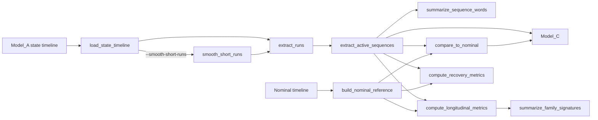

# Model_B: Behavioral Sequence Analysis

`Model_B` (package `iabm_behavior`) is the second layer of the multi-scale
operational-evidence framework for low-intrusion industrial telemetry:

```
Model_A state inference -> Model_B behavioural sequences -> Model_C semantic modes -> Model_D incident evidence/episodes
```

It turns a per-sample timeline of integer operating states (bitmasks of
active components, `0` = idle) into contiguous **state runs**, **active
sequences** ("state words" such as `(1, 2)`), sequence-word summaries and,
when a nominal (healthy) reference timeline is available, anomaly-oriented
comparisons, longitudinal metrics, recovery metrics and coarse
incident-family signatures.

## Responsibilities

- load state timelines from Parquet, Excel or CSV
- optionally smooth short active transients before run extraction
- derive contiguous state runs
- group consecutive non-zero runs into active sequences (words)
- summarise repeated sequence words
- build a nominal word reference and compare observed words against it
  (edit distance for matching, DTW + relative duration drift for scoring)
- compute longitudinal metrics, recovery metrics and family signatures

## Pipeline position and internal flow



## Installation

Requirements (from `pyproject.toml`): Python `^3.10`, `numpy ^1.26`,
`pandas ^2.1`, `pyarrow ^14` (Parquet), `openpyxl ^3.1` (Excel); `pytest ^7.4`
for development.

With Poetry, from `src/Model_B`:

```bash
poetry install            # installs the package and the dev group
poetry run industrial-behavior --help
```

With pip (editable install), from `src/Model_B`:

```bash
pip install -e .
pip install pytest        # for the test suite
```

Installing registers the console script `industrial-behavior`
(`iabm_behavior.main:main`). Without installation, run from `src/Model_B`
with `python -m iabm_behavior.main`.

## Command-line usage

```text
industrial-behavior --input PATH --output-dir DIR
                    [--nominal-input PATH]
                    [--lang {es,en}]
                    [--state-column NAME]
                    [--smooth-short-runs]
                    [--min-duration-seconds FLOAT]
                    [--min-samples INT]
                    [--anomaly-threshold FLOAT]
                    [--output-format {xlsx,csv}]
```

| Option | Default | Meaning |
| --- | --- | --- |
| `--input` | required | Observed state timeline (`.parquet`, `.xlsx`/`.xls`, `.csv`). |
| `--nominal-input` | none | Nominal reference timeline; enables comparison reports. |
| `--output-dir` | required | Output directory (created if missing). |
| `--lang` | `en` | Interface language (`en` or `es`); use the two-token form `--lang es`. |
| `--state-column` | `Predicted_State` | State column name (`estado` is renamed automatically). |
| `--smooth-short-runs` | off | Relabel short active transients with the next active state (applied to both timelines). |
| `--min-duration-seconds` | `1.0` | Runs strictly shorter than this are eligible for smoothing. |
| `--min-samples` | `1` | Runs with at most this many samples are eligible for smoothing. |
| `--anomaly-threshold` | `1.0` | A sequence is anomalous when `anomaly_score >= threshold`. |
| `--output-format` / `--output_format` | `xlsx` | Report format. |

Analyse a state timeline and export CSV artefacts:

```bash
python -m iabm_behavior.main \
    --input ../../data/model_b_state_timeline.parquet \
    --output-dir ../../src/predictions/Model_B \
    --smooth-short-runs \
    --output-format csv
```

Compare a month against a nominal reference timeline:

```bash
python -m iabm_behavior.main \
    --input observed_timeline.parquet \
    --nominal-input nominal_timeline.parquet \
    --output-dir ./reports \
    --anomaly-threshold 1.0 \
    --output-format csv
```

## Python API

```python
import pandas as pd
from iabm_behavior import BehavioralSequenceAnalyzer

analyzer = BehavioralSequenceAnalyzer(state_column="Predicted_State")

timeline = pd.DataFrame(
    {"Predicted_State": [0, 1, 1, 2, 0, 4, 4, 0]},
    index=pd.date_range("2022-01-01", periods=8, freq="1s"),
)
# or: timeline = analyzer.load_state_timeline("timeline.parquet")

timeline = analyzer.smooth_short_runs(timeline, min_duration_seconds=1.0, min_samples=1)
runs = analyzer.extract_runs(timeline)                # list[StateRun]
sequences = analyzer.extract_active_sequences(timeline)  # list[ActiveSequence]
print([s.states for s in sequences])                  # [(1, 2), (4,)]
words = analyzer.summarize_sequence_words(sequences)  # DataFrame

nominal = analyzer.build_nominal_reference(sequences)  # normally from a healthy timeline
comparison = analyzer.compare_to_nominal(sequences, nominal, anomaly_threshold=1.0)
longitudinal = analyzer.compute_longitudinal_metrics(sequences, nominal, rolling_window=3)
recovery = analyzer.compute_recovery_metrics(sequences, nominal)
families = analyzer.summarize_family_signatures(longitudinal)
```

## Data contracts

### Input timeline

- A `Time` column (parsed with `pandas.to_datetime` and used as index) **or**
  a `DatetimeIndex` (Parquet only; CSV/Excel need the `Time` column).
- An integer state column (`--state-column`, default `Predicted_State`, or
  legacy `estado`). Values must be castable to `int`; `NaN` is not allowed.
- Rows are sorted by time on load.

### Time and duration conventions

- `start_time` / `end_time` of runs and sequences are the timestamps of the
  first and last sample (inclusive).
- `duration_seconds = end_time - start_time`, so a single-sample run lasts
  `0.0` s; a sequence's `total_duration_seconds` is the sum of its runs'
  durations (gaps between runs are not counted).

### Outputs (`<name>.<xlsx|csv>`)

Always written:

| File | Columns |
| --- | --- |
| `state_runs` | `state`, `start_time`, `end_time`, `sample_count`, `duration_seconds` |
| `active_sequences` | `start_time`, `end_time`, `states` (tuple text, e.g. `"(1, 2)"`), `total_duration_seconds`, `run_count` |
| `sequence_words` | `word`, `count`, `avg_duration_seconds` |

Written only with `--nominal-input` **and** at least one observed active
sequence:

| File | Columns |
| --- | --- |
| `sequence_comparison` | `observed_states`, `nominal_states`, `exact_match`, `state_distance`, `dtw_distance`, `duration_ratio_delta`, `anomaly_score`, `is_anomalous` |
| `sequence_longitudinal_metrics` | `sequence_index`, `states`, `recurrence_interval_seconds`, `sequence_persistence_ratio`, `over_activation_rate`, `transition_instability`, `duration_drift`, `rolling_divergence`, `nominal_match`, `anomaly_flag` |
| `recovery_metrics` | `anomaly_sequence_index`, `recovered_sequence_index`, `time_to_recovery_seconds`, `partial_recovery_score`, `post_intervention_regime_shift` |
| `incident_episode_metrics` | `incident_family_candidate`, `signature_word`, `count`, `mean_transition_instability`, `mean_duration_drift` |

Timezone-aware timestamps in `state_runs` and `active_sequences` are written
as strings (`%Y-%m-%d %H:%M:%S%z`). Rows of `sequence_comparison` are in the
same order as `active_sequences`; Model_C relies on this positional
alignment.

### Scoring summary

- Best nominal match: minimise (edit distance, |duration drift|, -count).
- `duration_ratio_delta = (d_obs - d_nom) / d_nom` (signed).
- `anomaly_score = dtw_distance + |duration_ratio_delta|`.
- Without any nominal word: `anomaly_score = len(word) + 1`.
- Family candidates: `nominal_cycle` (not anomalous),
  `recurrent_spurious_cycle` (instability >= 0.7), `process_saturation`
  (drift >= 0.5), otherwise `pump_abrupt_failure`.

## Configuration

There is no configuration file: behaviour is controlled by the CLI options
above or the keyword arguments of `BehavioralSequenceAnalyzer` methods.
Interface translations live in `locales/<lang>/LC_MESSAGES/messages.po`
(currently `en` and `es`) and are parsed by `iabm_behavior.utils`.

## Package layout

```text
src/Model_B/
├── iabm_behavior/
│   ├── __init__.py     # public API (analyzer + dataclasses)
│   ├── main.py         # CLI entry point
│   ├── sequences.py    # BehavioralSequenceAnalyzer and dataclasses
│   └── utils.py        # minimal .po-based i18n
├── locales/{en,es}/LC_MESSAGES/messages.po
├── tests/
├── pyproject.toml
└── README.md
```

## Testing

From `src/Model_B`:

```bash
python -m pytest -q tests
# or
poetry run pytest -q tests
```

`tests/conftest.py` puts the package root on `sys.path`, so the suite runs
without installation. `pytest.ini` disables the `dash` pytest plugin, which
may be present in the wider research environment.

## Batch orchestration

The repository-level utility `src/generate_model_bc_batch.py` uses `Model_B`
month by month to process the real historical campaign while preserving
restartability and manifest traceability.
