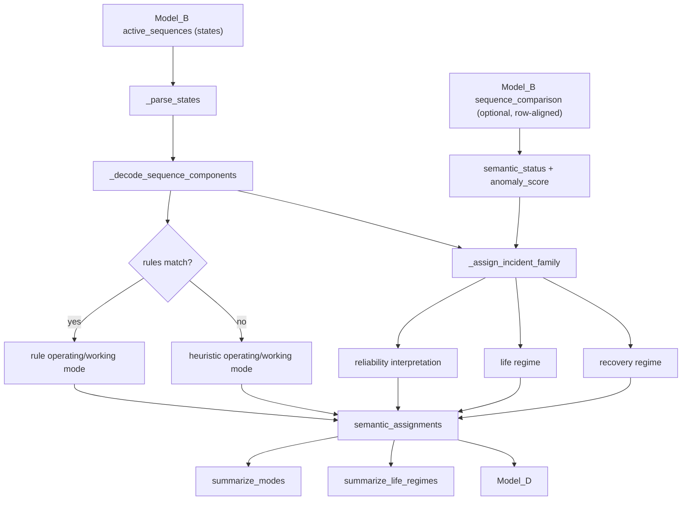

# Model_C: Semantic Mode Interpretation

`Model_C` (package `iabm_semantics`) is the third layer of the multi-scale
operational-evidence framework for low-intrusion industrial telemetry:

```
Model_A state inference -> Model_B behavioural sequences -> Model_C semantic modes -> Model_D incident evidence/episodes
```

It interprets the active sequences ("state words") produced by `Model_B` as
industrial component sets, operating and working modes, a semantic status,
incident-family proxies, reliability interpretations, and life/recovery
regimes that `Model_D` consumes.

## Responsibilities

- load `Model_B` active-sequence reports (Parquet, Excel, CSV)
- optionally enrich interpretation with the `Model_B` comparison report
- decode bitmask state words into industrial component sets
- infer operating and working modes (user JSON rules first, then heuristics)
- assign incident-family proxies, reliability interpretations, life and
  recovery regimes
- summarise modes and life regimes for downstream longitudinal analysis

## Interpretation flow



## Installation

Requirements (from `pyproject.toml`): Python `^3.10`, `pandas ^2.1`,
`pyarrow ^14` (Parquet), `openpyxl ^3.1` (Excel); `pytest ^7.4` for
development.

With Poetry, from `src/Model_C`:

```bash
poetry install
poetry run industrial-semantics --help
```

With pip (editable install), from `src/Model_C`:

```bash
pip install -e .
pip install pytest
```

Installing registers the console script `industrial-semantics`
(`iabm_semantics.main:main`). Without installation, run from `src/Model_C`
with `python -m iabm_semantics.main`.

## Command-line usage

```text
industrial-semantics --input PATH --output-dir DIR
                     [--comparison-input PATH]
                     [--rules JSON]
                     [--lang {es,en}]
                     [--output-format {xlsx,csv}]
```

| Option | Default | Meaning |
| --- | --- | --- |
| `--input` | required | Model_B `active_sequences` report. |
| `--comparison-input` | none | Model_B `sequence_comparison` report (row-aligned) used to set `semantic_status` and `anomaly_score`. |
| `--rules` | none | JSON rules file (see Configuration). |
| `--output-dir` | required | Output directory (created if missing). |
| `--lang` | `en` | Interface language (`en` or `es`); use the two-token form `--lang es`. |
| `--output-format` / `--output_format` | `xlsx` | Report format. |

Interpret a `Model_B` active-sequence report:

```bash
python -m iabm_semantics.main \
    --input ../Model_B/active_sequences.csv \
    --output-dir ./reports \
    --output-format csv
```

Interpret the same report while enriching semantic status with anomaly context:

```bash
python -m iabm_semantics.main \
    --input ../Model_B/active_sequences.csv \
    --comparison-input ../Model_B/sequence_comparison.csv \
    --output-dir ./reports \
    --output-format csv
```

## Python API

```python
import pandas as pd
from iabm_semantics import SemanticModeInterpreter, SemanticRule

interpreter = SemanticModeInterpreter(
    rules=[SemanticRule(("BASIN_PUMP",), "CUSTOM_MODE", "CUSTOM_WORK")],
)
sequences = pd.DataFrame({"states": ["(1, 2)", "(4, 1)", "(32,)"]})
comparison = pd.DataFrame(
    {"anomaly_score": [0.0, 1.2, 0.3], "is_anomalous": [False, True, False]}
)

assignments = interpreter.interpret_sequences(sequences, comparison=comparison)
modes = interpreter.summarize_modes(assignments)
regimes = interpreter.summarize_life_regimes(assignments)

# File-based equivalents:
# sequences = interpreter.load_active_sequences("active_sequences.csv")
# comparison = interpreter.load_comparison_report("sequence_comparison.csv")
# interpreter.load_rules("rules.json")
```

## Data contracts

### Inputs

- **Sequences** (`--input`): a `states` column holding state words as a
  tuple/list or as a string literal (`"(1, 2)"`, as written by the Model_B
  CLI). Other columns are ignored.
- **Comparison** (`--comparison-input`, optional): `anomaly_score` and
  `is_anomalous` columns. Rows are matched to sequences **by position**; extra
  sequence rows are treated as `NORMAL` with `anomaly_score = None`.

### State encoding (`DEFAULT_COMPONENT_MAP`)

| Bit | Component |
| --- | --- |
| 1 | `DIVING_PUMP_1` |
| 2 | `DIVING_PUMP_2` |
| 4 | `FEEDBACK_PUMP_1` |
| 8 | `FEEDBACK_PUMP_2` |
| 16 | `FLOCCULANT_PUMP` |
| 32 | `BASIN_PUMP` |

The component set of a word is the union of the components of all its states.

### Heuristic modes (when no rule matches)

| Condition (first match wins) | operating_mode | working_mode |
| --- | --- | --- |
| no components | `IDLE` | `NO_ACTIVE_COMPONENTS` |
| `BASIN_PUMP` present | `TRANSFER_MODE` | `BASIN_TRANSFER` |
| flocculant + any diving pump | `TREATMENT_MODE` | `FLOCCULANT_ASSISTED_CYCLE` |
| any feedback + any diving pump | `RECIRCULATION_MODE` | `DIVING_FEEDBACK_CYCLE` |
| only diving pumps | `PUMPING_MODE` | `DIVING_ONLY` |
| only feedback pumps | `RECIRCULATION_MODE` | `FEEDBACK_ONLY` |
| otherwise | `COMPOSITE_MODE` | components joined by `+` |

### Status, family and regimes

- `semantic_status`: `ANOMALOUS` if the aligned comparison row has
  `is_anomalous = True`, else `NORMAL`.
- `NORMAL` rows always get `incident_family = post_intervention_recovery`,
  `reliability_interpretation = nominal_or_stable_regime`,
  `life_regime = nominal_operation`, `recovery_regime = stable_recovered`.
- `ANOMALOUS` rows (score `s`): `process_saturation` (flocculant, `s >= 1.0`),
  `float_recurrent_disturbance` (feedback pump, `s >= 1.0`),
  `pump_abrupt_failure` (diving pump, `s >= 1.5`), otherwise
  `external_ambiguous_disturbance`. Reliability, life and recovery labels
  are then derived from the family (see
  `iabm_semantics/semantics.py` docstrings for the full mapping).

### Outputs (`<name>.<xlsx|csv>`)

| File | Columns |
| --- | --- |
| `semantic_assignments` | `sequence_states`, `components`, `operating_mode`, `working_mode`, `semantic_status`, `anomaly_score`, `incident_family`, `reliability_interpretation`, `life_regime`, `recovery_regime` |
| `incident_family_assignments` | same content as `semantic_assignments` (alias export) |
| `semantic_mode_summary` | `operating_mode`, `working_mode`, `semantic_status`, `incident_family`, `life_regime`, `count` |
| `asset_life_regime_summary` | `incident_family`, `life_regime`, `recovery_regime`, `reliability_interpretation`, `count` |

Summaries are sorted by `count` (descending).

## Configuration

Optional rules file (`--rules` or `SemanticModeInterpreter.load_rules`): a
JSON array evaluated in order; a rule matches when all its
`required_components` are present in the sequence's component set (an empty
list matches everything). Rules replace only the mode assignment; status,
family and regime logic is unchanged.

```json
[
  {
    "required_components": ["BASIN_PUMP"],
    "operating_mode": "CUSTOM_MODE",
    "working_mode": "CUSTOM_WORK"
  }
]
```

A custom bitmask mapping can be passed programmatically via
`SemanticModeInterpreter(component_map={...})` (not exposed on the CLI).
Interface translations live in `locales/<lang>/LC_MESSAGES/messages.po`
(`en`, `es`).

## Package layout

```text
src/Model_C/
├── iabm_semantics/
│   ├── __init__.py     # public API
│   ├── main.py         # CLI entry point
│   ├── semantics.py    # SemanticModeInterpreter, SemanticRule, SemanticAssignment
│   └── utils.py        # minimal .po-based i18n
├── locales/{en,es}/LC_MESSAGES/messages.po
├── tests/
├── pyproject.toml
└── README.md
```

## Testing

From `src/Model_C`:

```bash
python -m pytest -q tests
# or
poetry run pytest -q tests
```

`tests/conftest.py` puts the package root on `sys.path`, so no installation
is needed. `pytest.ini` disables the `dash` pytest plugin.

## Batch orchestration

The repository-level utility `src/generate_model_bc_batch.py` couples
`Model_B` and `Model_C` month by month so semantic interpretation can scale to
large historical telemetry archives without losing manifest traceability.
