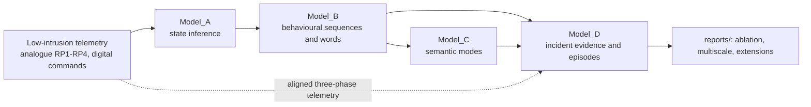
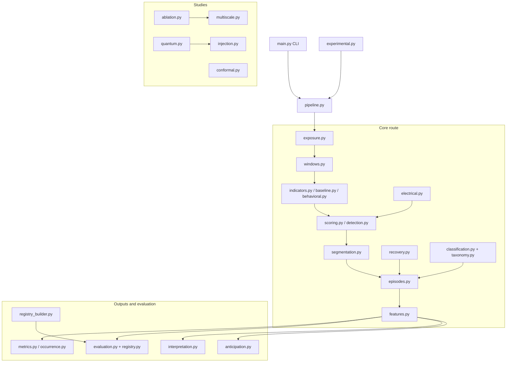
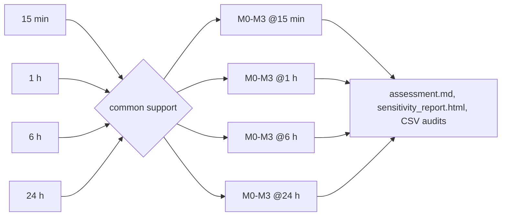
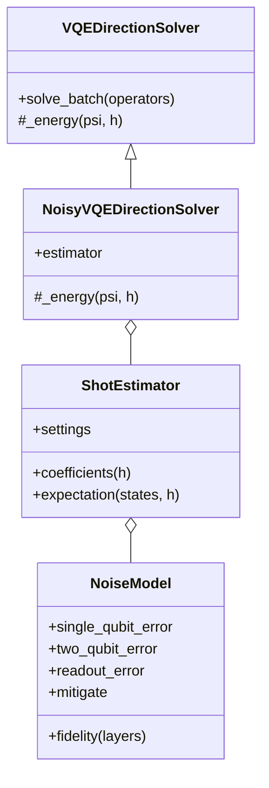

# Model_D: incident evidence, episodes and evidence studies

`Model_D` (Python package `iabm_incidents`) is the longitudinal incident layer
of the multi-scale operational-evidence framework for low-intrusion industrial
telemetry. It turns behavioural and semantic evidence from the upstream
models, optionally enriched with three-phase electrical command-response
evidence, into:

- window-level incident evidence and a deviation score,
- candidate incident episodes with onset, peak and recovery,
- explainable incident-family assignments,
- recovery assessments and family-level occurrence summaries,
- evaluation against canonical or weakly labelled incident registries,
- the matched **M0–M3 evidence ablation**, a prespecified **multiscale
  sensitivity**, and methodological extensions (**conformal fusion**,
  **certified variational fourth-order evidence**, **NISQ noise model** and a
  **semi-synthetic fault-injection benchmark**).

Families and episodes are *operational evidence categories*: none of the
scores establishes a confirmed physical failure, and derived registries are
weak references, never independent truth.

## Position in the framework



## Package layout



| Module | Responsibility |
| --- | --- |
| `config.py` | Typed configuration (`ModelDConfig`, windows, detection, weights, family assignment, occurrence) and JSON loading |
| `exposure.py` | Observation periods and exclusions (gaps, registry intervals) |
| `windows.py` | Rolling analysis windows with coverage and validity flags |
| `indicators.py`, `baseline.py`, `behavioral.py` | Seven behavioural window indicators and their nominal baselines |
| `electrical.py` | Command-response observer, fourth-order transient concentration (Tconc), exact and VQE direction solvers |
| `detection.py`, `scoring.py` | Weighted deviation score and scorer protocol |
| `segmentation.py`, `recovery.py`, `episodes.py`, `features.py` | Episode segmentation, recovery hysteresis, episode materialisation and descriptors |
| `classification.py`, `taxonomy.py` | Explainable rule- and signature-based family assignment over five families |
| `registry.py`, `registry_builder.py`, `evaluation.py` | Registry normalisation, weak candidate-registry generation and episode evaluation |
| `metrics.py`, `occurrence.py` | Family summaries and exposure-aware occurrence rates |
| `interpretation.py` | Post hoc event-conditioned FIR/Bode interpretation |
| `anticipation.py` | Anticipatory maintenance risk forecasting |
| `pipeline.py`, `experimental.py`, `main.py` | Indicator pipeline, experiment runner and CLI |
| `ablation.py`, `multiscale.py` | M0–M3 matched ablation and window-length sensitivity |
| `conformal.py`, `quantum.py`, `injection.py` | Conformal fusion, quantum-information view/certificates/noise model, fault injection |

## Installation

The package is managed with Poetry (`src/Model_D/pyproject.toml`, package
`industrial-incidents-model-d`, Python `^3.10`). Runtime dependencies are
pandas `^2.1`, numpy `>=1.24,<3`, pyarrow `^14` and openpyxl `^3.1`;
matplotlib is an optional extra (`analysis`) used only for figures. pytest is a
development dependency.

```bash
cd src/Model_D
poetry install                    # core
poetry install --extras analysis  # with matplotlib figures
# or, without Poetry, from the repository root:
export PYTHONPATH=src/Model_D
```

`src/run_model_d_extensions.py --stage fusion` additionally needs
scikit-learn (Isolation Forest baseline), which is not declared in
`pyproject.toml`.

## Command-line interface

The console script `industrial-incidents` (equivalently
`python -m iabm_incidents.main`) exposes the following options:

| Option | Meaning |
| --- | --- |
| `--detection-mode {semantic,indicators}` | Episode route (default `semantic`). `indicators` builds windows and indicator scores before segmentation. |
| `--sequences PATH` | Model_B active-sequence report. |
| `--assignments PATH` | Model_C assignment report. |
| `--registry PATH` | Optional canonical incident registry. |
| `--analogue PATH`, `--digital PATH` | Optional telemetry tables for indicator-driven observation exposure. |
| `--workbook PATH` | Single Excel workbook containing the inputs. |
| `--sequences-sheet`, `--assignments-sheet`, `--registry-sheet` | Sheet names (defaults `sequences`, `assignments`, `registry`). |
| `--config PATH` | Model_D JSON configuration (see `configs/model_d.example.json`). |
| `--output-dir PATH` | Required output directory. |
| `--output-format {xlsx,csv}` | Report format (default `xlsx`; `--output_format` is accepted as an alias). |

Either `--workbook` or both `--sequences` and `--assignments` are required.
A workbook that contains a `Window_indicators` sheet (with `Incident_registry`
and `Observation_exposure`) is treated as pre-windowed indicator input.

```bash
# Legacy semantic route
python -m iabm_incidents.main --sequences active_sequences.csv \
    --assignments semantic_assignments.csv --output-dir outputs/model_d --output-format csv

# Indicator route with configuration and registry alignment
python -m iabm_incidents.main --detection-mode indicators \
    --config configs/model_d.example.json \
    --sequences active_sequences.csv --assignments semantic_assignments.csv \
    --registry candidate_incident_registry_refined.csv \
    --output-dir outputs/model_d --output-format csv
```

Outputs: `window_scores`, `detected_episodes`, `family_assignments`,
`recovery_assessment`, `evaluation_summary`, `occurrence_summary`,
`model_d_run_metadata.json`; in indicator mode also `observation_periods` and
`analysis_windows`; with a registry also `incident_registry_matches` and
`registry_evaluation_summary`.

## Python API

### Indicator pipeline

```python
from iabm_incidents import IndicatorPipeline, ModelDConfig

pipeline = IndicatorPipeline(ModelDConfig())
result = pipeline.run(sequences=sequences, assignments=assignments, registry=registry)
result.window_scores      # one row per analysis window, with deviation_score
result.episodes           # segmented and enriched episodes
```

### Frozen electrical evidence

Fit the observer on a declared nominal training partition and the transient
reference on a separate nominal reference partition. The pipeline never fits
these models on evaluated windows.

```python
from iabm_incidents import (ElectricalConfig, CommandResponseObserver,
                            TransientConcentration, VQEDirectionSolver, IndicatorPipeline)

cfg = ElectricalConfig(sample_period_seconds=0.807)   # use the verified source cadence
observer = CommandResponseObserver(cfg).fit(nominal_training)
transients = TransientConcentration(cfg, solver=VQEDirectionSolver()).fit(
    observer.residuals(nominal_reference))            # omit solver for exact-only Tconc
pipeline = IndicatorPipeline(command_observer=observer, transient_model=transients)
result = pipeline.run(sequences=sequences, assignments=assignments,
                      analogue=aligned_electrical_telemetry, digital=digital)
```

Both electrical models must be supplied together and share the same
`ElectricalConfig`; analogue telemetry is then mandatory. Alignment of
analogue/digital telemetry is the caller's responsibility.

### Candidate registry and evaluation

```python
from iabm_incidents import CandidateIncidentRegistryBuilder, IncidentRegistry

registry = CandidateIncidentRegistryBuilder().build_from_files(
    states_path="estados.parquet", sequences_path="sequences.parquet", words_path="words.parquet")
matches = IncidentRegistry().match_candidates(registry, result.episodes)
```

### Extensions

```python
import numpy as np
from iabm_incidents.conformal import ConformalEvidenceFusion
from iabm_incidents.quantum import (NoiseModel, ShotEstimator, NoisyVQEDirectionSolver,
                                    information_profile, kato_temple_bounds)

fusion = ConformalEvidenceFusion(["sequence_divergence", "transient_concentration"]).fit(calibration)
pvalues = fusion.transform(test)          # p_<column>, p_fused, fused_score, dominant_evidence
onset, recovery = fusion.thresholds       # -log10(alpha) thresholds

bounds = kato_temple_bounds(operator, direction)    # rigorous Frobenius-gap certificate
estimator = ShotEstimator(1024, NoiseModel(1e-3, 1e-2, 2e-2, True))
noisy_solver = NoisyVQEDirectionSolver(estimator)
```

## Data contracts

### Window indicators

| Column | Meaning |
| --- | --- |
| `window_id`, `asset_id` | Window key (`<asset>_<ISO start>`) and asset |
| `start_time`, `end_time` | Naive-UTC window bounds |
| `data_coverage`, `is_valid` | Effective observed fraction and `>= min_coverage` flag |
| `sequence_divergence`, `duration_drift`, `recurrence_excess`, `persistence_excess`, `consumption_deviation`, `state_error_rate`, `mode_divergence` | Seven behavioural indicators |
| `command_response_deviation` | Mean norm of state-standardised three-phase residuals (with signed `command_response_signed_RP*` and `command_response_imbalance`) |
| `transient_concentration` | Exact Tconc; `transient_concentration_vqe` and `transient_solver_deficit` when a VQE solver is configured |
| `electrical_status`, `electrical_safe_fraction`, `transient_supported_fraction` | Electrical support audit |
| `semantic_status`, `incident_family` | Model_C semantic evidence |
| `deviation_score` | Weighted score used for segmentation |

Pre-windowed CLI workbooks use `window_start`/`window_end` plus
`sequence_count` and `active_sequence_count`.

### Incident registry

`incident_id`, `source_window_start`, `source_window_end`,
`documented_start`, `documented_end`, `event_time`, `event_time_precision`,
`incident_family` (mirrored as `family`), `secondary_family`,
`recovery_time`, `recovery_status`, `label_strength`
(`confirmed`/`strong`/`weak`), `source_type`, `downtime_start`,
`downtime_end`, `maintenance_time`, `affected_subsystem`, `notes`,
`asset_id`. `IncidentRegistry.normalize` parses timestamps, mirrors the
family columns, fills source windows from documented spans and generates
missing identifiers. The candidate builder emits `AUTO-nnnnnn` identifiers
with `label_strength="weak"`.

### Incident families

`pump_abrupt_failure` (high severity), `float_recurrent_disturbance`,
`process_saturation`, `post_intervention_recovery` and
`external_ambiguous_disturbance` (see `taxonomy.py`).

## The evidence vector

```text
x_w = [sequence_divergence, duration_drift, recurrence_excess, persistence_excess,
       consumption_deviation, state_error_rate, mode_divergence,     # 7 behavioural
       command_response_deviation,                                   # command response
       transient_concentration]                                      # Tconc
S_w = sum_k weight_k * x_w,k        (missing coordinates contribute 0)
```

Causal electrical coordinates are RP1–RP3 at the current and previous sample
plus common mode at lags two and three (`p = 8`), centred and whitened per
asset and controller state on the nominal reference partition:

```text
F(z) = mean[(||z||^2 / 8) z z^T]
D_w  = (F_w - F_0) / s_0,     s_0 = max(trace(F_0) / 8, 1e-8)
Tconc = max(lambda_max(D_w), 0) ** (1/4)
```

The exact eigensolver defines `transient_concentration`. The optional
`VQEDirectionSolver` maximises the Rayleigh quotient of the same `D` with three
simulated qubits (RY/CX layers, Rotosolve, independent restarts, no exact
initialisation or fallback). Unsupported electrical evidence is `NaN` with an
explicit `electrical_status`; it contributes zero to the weighted score, which
means *unavailable evidence*, not healthy telemetry. JSON weights
`command_response` and `transient_concentration` default to 1.0 and require
held-out nominal calibration before operational use.

## M0–M3 ablation

`FourLevelAblationRunner` evaluates nested evidence levels on common supported
windows:

| Level | Coordinates |
| --- | --- |
| M0 | seven behavioural indicators |
| M1 | M0 + `command_response_deviation` |
| M2 | M1 + exact `transient_concentration` |
| M3 | M1 + `transient_concentration_vqe` (VQE replaces the exact coordinate) |

Centres/scales use the reference phase only; onset/recovery thresholds are the
0.95/0.80 quantiles of the calibration phase; M3 shares the M2 thresholds by
default (isolating solver approximation). Risk horizons are 6, 24, 72 and
168 h for `pump_abrupt_failure` and `process_saturation`. In the shipped
focused 2022 run (`reports/four_level_ablation/2022_focused`) 529 matched test
windows give 371 warnings for M0/M1 and 374 for M2/M3, with identical M2/M3
decisions.

## Multiscale sensitivity

`MultiscaleSensitivityRunner` executes one prespecified sensitivity at
**15 min, 1 h, 6 h and 24 h** on a common **15-minute decision grid**. All
scales must share asset/endpoint/phase keys; support is intersected across
scales (finite ten-column evidence, coverage, `electrical_status ==
"supported"`), the retrospective event cohort is fixed from common-supported
shortest test windows, and the risk holdout start (2022-08-19) is fixed. The
electrical observer, whitening and fourth-order reference are frozen;
behavioural references, scaling and thresholds are re-estimated per scale on
the original partitions. No best scale is selected. The shipped common cohort
retains 271 test endpoints.



## Conformal fusion

`conformal.py` converts each evidence coordinate into a smoothed conformal
p-value against the frozen calibration partition,
`p = (#{c > s} + U (#{c = s} + 1)) / (n + 1)`, and fuses coordinates (and
scales) with the Cauchy combination test (ACAT). The fused score is
`-log10(p_fused)`; default onset/recovery levels are `alpha = 0.05 / 0.20`,
and the minimum-p coordinate is reported as `dominant_evidence`. Validity is
marginal and assumes calibration exchangeability; overlapping windows weaken
it, so calibration warning rates are reported rather than assumed.

## Certified VQE and noise model

`quantum.py` treats `F / tr F` as a three-qubit density operator:

- **Magnitude vs shape:** `kurtosis_ratio = tr F / tr F0` versus quantum
  Jensen–Shannon divergence and trace distance between trace-normalised
  operators (insensitive to uniform energy changes).
- **Measurement model:** a real symmetric 8 × 8 operator has 36 non-zero Pauli
  strings (even number of Y), grouped greedily into 14 qubit-wise-commuting
  bases. `ShotEstimator` simulates finite shots per basis, global depolarising
  noise with fidelity `f = (1-p1)^(3L) (1-p2)^(2L)` and symmetric readout flips
  `e`, and optionally mitigates by `1 / (f (1-2e)^k)` for a weight-`k` string.
  `NoisyVQEDirectionSolver` overrides only `_energy`, so every Rotosolve
  accept/reject decision uses noisy energies.
- **Kato–Temple certificates:** `rho = v^T D v` is a rigorous lower bound on
  `lambda_max`; with `sigma^2 = ||Dv||^2 - rho^2` and the Frobenius gap
  reference `alpha_F = sqrt(||D||_F^2 - rho^2) >= |lambda_2|` (valid when
  `rho >= 0`), `lambda_max <= rho + sigma^2 / (rho - alpha_F)` whenever
  `rho > alpha_F`, capped by `||D||_F`. If `rho < 0`, Kato–Temple is not
  applicable and only the `||D||_F` cap is used. A VQD-estimated second
  eigenvalue (`deflated_second_direction`) is only a lower estimate of
  `lambda_2`, so the gap-assisted variant is **not rigorous**.

Every routine is a classical simulation; no quantum advantage is claimed.



## Fault-injection benchmark

`injection.py` injects known faults into genuine nominal residuals through the
frozen observer, `r = (y - c_s) / s_s`, so null behaviour, switching, gaps and
serial dependence remain those of the real asset. Scenarios (`Injection`) are
`under_response` (multiplicative power loss on selected phases), `bursts`
(sign-random transients at a Poisson rate) and `dropouts` (short partial or
total loss of one phase). `window_statistics` evaluates
`mean_residual_norm`, `mean_shift`, `second_order`, `fourth_order` (Tconc),
`kurtosis_ratio` and `qjsd` per controller-state context and aggregates by the
maximum, exactly like Tconc.

## Reproducibility scripts

Run from the repository root with raw data under `data/`. The shipped runs
pin BLAS/OpenMP to one thread, as shown below.

| Script | Purpose | Default output |
| --- | --- | --- |
| `src/run_model_d_ablation.py [--reuse-indicators] [--refresh-behavioral] [--data-dir data]` | Focused 2022 M0–M3 ablation, 24-h windows updated hourly | `reports/four_level_ablation/2022_focused` |
| `src/run_model_d_multiscale.py [--reuse-indicators] [--primary-dir ...] [--data-dir data]` | 15 min / 1 h / 6 h / 24 h sensitivity (primary study read-only) | `reports/four_level_ablation/multiscale_sensitivity` |
| `src/run_model_d_extensions.py --stage {model_a,quantum,telemetry,fusion,all}` | Model_A diagnostics, certificates and noise studies, injection benchmark, conformal fusion | `reports/extensions` |
| `src/export_extension_figure_data.py` | Compact CSVs behind the manuscript extension figures | `reports/extensions/figure_data` |

```bash
OPENBLAS_NUM_THREADS=1 OMP_NUM_THREADS=1 PYTHONPATH=src/Model_D python src/run_model_d_ablation.py
OPENBLAS_NUM_THREADS=1 OMP_NUM_THREADS=1 PYTHONPATH=src/Model_D python src/run_model_d_multiscale.py
OPENBLAS_NUM_THREADS=1 OMP_NUM_THREADS=1 PYTHONPATH=src/Model_D python src/run_model_d_extensions.py --stage all
PYTHONPATH=src:src/Model_D python src/export_extension_figure_data.py
```

`reports/extensions` contains, among others, `certificates_<scale>.csv`,
`certificate_summary.csv`, `information_<scale>.parquet`,
`shot_noise_study.csv`, `noisy_vqe_study.csv`, `decision_margins.csv`,
`swap_test_shots.csv`, `order_statistics_primary.parquet`,
`injection_windows.parquet`, `injection_summary.csv`,
`conformal_primary_pvalues.csv`, `fusion_summary.csv`,
`fusion_attribution.csv`, `model_a_class_metrics.csv`,
`model_a_period_metrics.csv` and `extensions_metadata.json`.

Detailed protocols and executed results are documented in the Sphinx pages
[`model_d_ablation`](../../docs/model_d_ablation.rst),
[`model_d_multiscale`](../../docs/model_d_multiscale.rst),
[`model_d_extensions`](../../docs/model_d_extensions.rst) and
[`event_frequency_interpretation`](../../docs/event_frequency_interpretation.rst).

## Testing

```bash
cd src/Model_D
python -m pytest -q tests
```

The suite covers configuration, indicators, episodes, electrical evidence,
interpretation, anticipation, ablation, multiscale sensitivity, the
experiment runner, the CLI, the registry builder and the extensions
(`tests/test_extensions.py`).

## Maintenance notes

- Leakage guards: electrical models are frozen before scoring; ablation
  scaling uses reference windows only and thresholds calibration windows only;
  no held-out result selects window length, threshold, circuit budget or risk
  model.
- Several frame-based helpers (`recovery.py`, `segmentation.py`) assume a
  default `RangeIndex` because they mix positional and label indexing.
- Derived registries and fixed derived-event risk targets are exploratory
  references; independent maintenance truth is not available for the
  focused 2022 interval.
