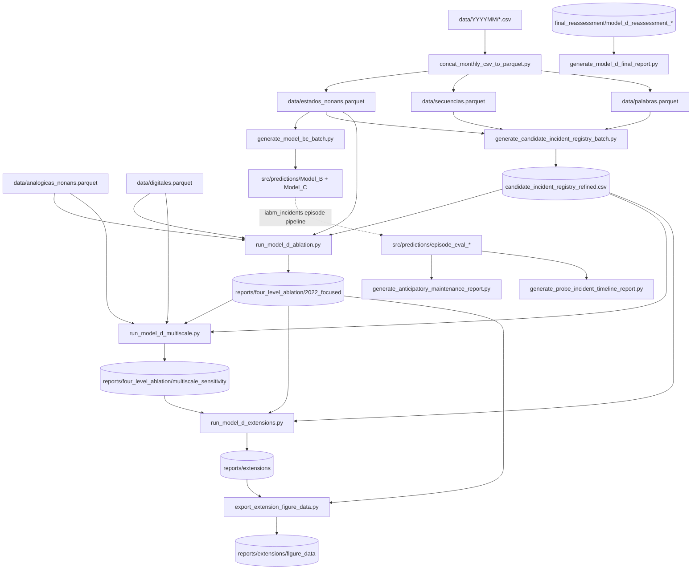

# Source Tree Guide

This directory holds the four implementation packages of the multi-scale
operational-evidence framework, the top-level batch and experiment scripts
that orchestrate them, and the retained generated artefacts under
`predictions/`. Every command below runs **from the repository root**; the
scripts use paths relative to the current working directory.

The Sphinx site in `docs/` renders the docstrings of all scripts and packages
(autodoc + napoleon); `docs/reproducibility.rst` is the short version of the
execution order given here.

## Layout

| Path | Content |
| --- | --- |
| `Model_A/` | Package `iabm`: elementary operating-state inference from synchronised analogue (RP1-RP3) and digital (controller command) signals. |
| `Model_B/` | Package `iabm_behavior`: contiguous state runs, active sequences (consecutive non-idle runs), sequence words, nominal comparison and longitudinal metrics. |
| `Model_C/` | Package `iabm_semantics`: semantic interpretation of sequences into operating/working modes, semantic status, incident families, life and recovery regimes. |
| `Model_D/` | Package `iabm_incidents`: incident evidence and episodes (windows, scoring, detection, segmentation, recovery, evaluation, occurrence), weak candidate registry builder, M0-M3 ablation, multiscale sensitivity, conformal fusion, fault injection and certified variational (VQE) fourth-order evidence. |
| `predictions/` | Retained outputs of the batch scripts and Model_D episode evaluations (see `predictions/README.md`). |
| `*.py` | Top-level scripts described below. |

Each package is an independent Poetry project (`pyproject.toml`) with its own
tests (`tests/`) and README. The top-level scripts import the packages either
through the script folder `src/` (which Python puts on `sys.path`
automatically, giving e.g. `Model_D.iabm_incidents`) or through
`PYTHONPATH=src/Model_D` (giving `iabm_incidents`).

## Top-level scripts

| Script | Role | How to run | Main inputs | Main outputs |
| --- | --- | --- | --- | --- |
| `concat_monthly_csv_to_parquet.py` | Concatenate `data/<YYYYMM>/*.csv` into one Parquet per CSV name | `python src/concat_monthly_csv_to_parquet.py --data-dir data --include-source-month` | `data/<YYYYMM>/{estados_nonans,secuencias,palabras}.csv` | `data/{estados_nonans,secuencias,palabras}.parquet` |
| `generate_model_bc_batch.py` | Month-wise Model_B -> Model_C | `python src/generate_model_bc_batch.py --output-dir src/predictions` | `data/estados_nonans.parquet` | `src/predictions/Model_B/`, `src/predictions/Model_C/`, `model_bc_batch_manifest.csv`, `model_bc_batch_metadata.json` |
| `generate_candidate_incident_registry_batch.py` | Month-wise weak candidate incident registry | `python src/generate_candidate_incident_registry_batch.py --output-dir src/predictions/Model_D` | `data/{estados_nonans,secuencias,palabras}.parquet` | `src/predictions/Model_D/candidate_incident_registry_refined*`, `monthly_candidate_registry/` |
| `run_model_d_ablation.py` | Primary M0-M3 ablation (2022-07-01 to 2022-09-11, 24 h windows, hourly step) | `PYTHONPATH=src/Model_D python src/run_model_d_ablation.py` | `data/analogicas_nonans.parquet`, `data/digitales.parquet`, `data/estados_nonans.parquet`, registry CSV | `reports/four_level_ablation/2022_focused/` |
| `run_model_d_multiscale.py` | Window-length sensitivity (15 min, 1 h, 6 h, 24 h on a 15-minute grid) | `PYTHONPATH=src/Model_D python src/run_model_d_multiscale.py` | primary ablation folder, raw data, registry CSV | `reports/four_level_ablation/multiscale_sensitivity/` |
| `run_model_d_extensions.py` | Model_A diagnostics, quantum certificates and resources, fault injection, conformal fusion | `PYTHONPATH=src/Model_D python src/run_model_d_extensions.py --stage all` | primary and multiscale folders, raw data, registry CSV | `reports/extensions/` |
| `export_extension_figure_data.py` | Compact pgfplots tables for the manuscript figures | `PYTHONPATH=src:src/Model_D python src/export_extension_figure_data.py` | `reports/extensions/*.csv`, primary folder | `reports/extensions/figure_data/` |
| `generate_model_d_final_report.py` | Executive tables and charts of the full-horizon Model_D reassessment | `python src/generate_model_d_final_report.py` | `src/predictions/Model_D/final_reassessment/model_d_reassessment_*` | same folder: `model_d_final_*`, PNG charts, HTML |
| `generate_anticipatory_maintenance_report.py` | Horizon risk forecaster on retained episodes | `python src/generate_anticipatory_maintenance_report.py --dataset probe` | `src/predictions/episode_eval_<dataset>/Model_D_episodes_localized_fallback/` | `.../anticipation_report/` |
| `generate_probe_incident_timeline_report.py` | Episodes versus reported maintenance and work orders (2024-02 to 2026-04) | `python src/generate_probe_incident_timeline_report.py --dataset probe` | two Word files under `/tmp` (not distributed), retained episode folders | `.../comparison_report/` |

## Reproducing the manuscript

### Data prerequisites (`data/`)

| File | Required by | Required columns |
| --- | --- | --- |
| `data/analogicas_nonans.parquet` | ablation, multiscale, extensions (`telemetry`) | `0` (timestamp), `RP1`, `RP2`, `RP3` |
| `data/digitales.parquet` | ablation, multiscale, extensions (`telemetry`) | `0` (timestamp), `estado` (controller command) |
| `data/estados_nonans.parquet` | Model_B/C batch, registry batch, ablation, extensions (`model_a`) | `source_month`, `date`, `estado`, `pred_estado`, `RP1`-`RP4` |
| `data/secuencias.parquet`, `data/palabras.parquet` | registry batch | `source_month` plus the sequence/word summaries |

`estados_nonans`, `secuencias` and `palabras` are produced from monthly folders
`data/<YYYYMM>/` by `concat_monthly_csv_to_parquet.py`; pass
`--include-source-month`, because every batch runner filters on
`source_month`. `data/*.parquet` is excluded by `.gitignore` and routed through
Git LFS by `.gitattributes`; obtain the files as described in `data/README.md`.

### Execution order

```bash
# 0. Optional: consolidate monthly CSV exports
python src/concat_monthly_csv_to_parquet.py --data-dir data --include-source-month

# 1. Longitudinal layers (optional for the paper tables; long running)
python src/generate_model_bc_batch.py --output-dir src/predictions
python src/generate_candidate_incident_registry_batch.py --output-dir src/predictions/Model_D

# 2. Primary M0-M3 ablation
OPENBLAS_NUM_THREADS=1 OMP_NUM_THREADS=1 PYTHONPATH=src/Model_D \
    python src/run_model_d_ablation.py

# 3. Multiscale sensitivity (verifies the primary folder is unchanged)
PYTHONPATH=src/Model_D python src/run_model_d_multiscale.py

# 4. Extensions (stages: model_a, quantum, telemetry, fusion; order matters)
PYTHONPATH=src/Model_D python src/run_model_d_extensions.py --stage all

# 5. Figure data for pgfplots
PYTHONPATH=src:src/Model_D python src/export_extension_figure_data.py
```

Steps 2-4 read
`src/predictions/Model_D/candidate_incident_registry_refined.csv`. If it is
not present, rebuild it with step 1, or re-consolidate it from the
distributed monthly registries without the raw inputs:

```bash
python src/generate_candidate_incident_registry_batch.py --skip-existing-months \
    --months $(ls src/predictions/Model_D/monthly_candidate_registry | sed 's/.parquet//')
```

Re-evaluation without re-materialisation is available for steps 2 and 3
(`--reuse-indicators`); the multiscale reuse fails closed if the cached
metadata no longer matches the frozen primary artefacts.



### Chronological boundaries of the focused study

Defined once in `run_model_d_ablation.BOUNDARIES` (naive UTC; each interval
includes its start and excludes its end) and reused by the multiscale and
extension scripts:

| Partition | Interval | Used for |
| --- | --- | --- |
| observer fit | 2022-07-01 to 2022-07-22 | command-response observer, behavioural baseline |
| reference | 2022-07-22 to 2022-08-05 | fourth-order transient reference, multivariate baselines |
| calibration | 2022-08-05 to 2022-08-19 | thresholds, conformal calibration, fault-injection benchmark |
| test | 2022-08-19 to 2022-09-11 | all reported results |

Windows straddling a boundary are labelled `excluded_boundary`.

## Expected outputs

* `reports/four_level_ablation/2022_focused/`: raw indicators, frozen
  observer and electrical reference, operators and VQE directions,
  provenance with SHA-256 hashes, `summary.csv`, `pairwise.csv`,
  `calibration.csv`, `support.csv`, level folders `M0`-`M3`, `assessment.md`,
  `ablation_report.html` and three PNG figures.
* `reports/four_level_ablation/multiscale_sensitivity/`: `window_<m>min/`
  folders, `summary.csv`, `pairwise.csv`, `risk_metrics.csv`,
  `availability.csv`, `sensitivity_metadata.json`, `input_source_audit.json`,
  `primary_artifact_integrity.json`, `assessment.md`,
  `sensitivity_report.html`, `multiscale_sensitivity.png`.
* `reports/extensions/`: Model_A metrics, certificates and information
  profiles per scale, shot/noise and noisy-VQE studies, order statistics,
  fault-injection benchmark, conformal fusion tables,
  `extensions_metadata.json` and `figure_data/`.
* `src/predictions/`: see `predictions/README.md`.

## Runtimes

No runtime is hard-coded in the scripts, but the retained metadata record:

| Step | Recorded time | Source |
| --- | --- | --- |
| Ablation materialisation, including VQE | about 160 s | `encoding_seconds` in `2022_focused/input_provenance.json` |
| Multiscale materialisation (four scales) | about 710 s | `materialization_elapsed_seconds` in `sensitivity_metadata.json` |
| Multiscale re-evaluation (`--reuse-indicators`) | about 24 s | `elapsed_seconds` in `sensitivity_metadata.json` |
| Extensions, last recorded run | about 140 s | `elapsed_seconds_last_run` in `extensions_metadata.json` |

The month-wise Model_B/C and registry batches scale with the campaign length
(50 available months between 2022-01 and 2026-06) and are the longest
running steps; they print one line per month and can be resumed with
`--skip-existing-months`.

## Maintenance notes

* The primary ablation folder is treated as immutable: the multiscale and
  extension scripts hash it before and after running and abort on changes.
  Regenerating it invalidates both downstream studies.
* `input_provenance.json`, `sensitivity_metadata.json` and
  `extensions_metadata.json` store SHA-256 hashes of the scripts and Model_D
  modules that were used. Editing any of them (including docstrings) changes
  the hashes recorded by the next run; the reuse checks compare artefact
  hashes, not source hashes, so existing caches stay usable.
* The module docstrings of the three `run_model_d_*` scripts double as their
  `--help` text.
* `generate_probe_incident_timeline_report.py` reads Word documents from
  `/tmp` that are not distributed; its retained `comparison_report/` folders
  are the reference outputs.
