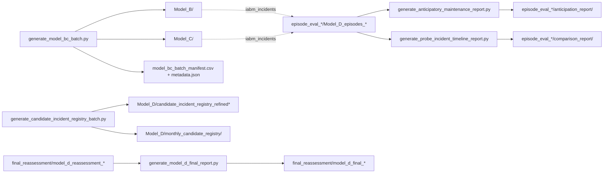

# Predictions Directory Guide

This folder holds generated artefacts of the layered workflow: monthly batch
outputs of Model_B/Model_C and of the weak candidate incident registry, the
retained Model_D episode evaluations, and reports derived from them. The
outputs of the focused M0-M3 ablation, multiscale sensitivity and extension
studies are **not** stored here but under `reports/` at the repository root
(see `src/README.md`).

All paths below are relative to `src/predictions/`; all scripts run from the
repository root.

## What is distributed and what is regenerated

* **Distributed (small summaries).** The CSV/JSON/PNG/HTML summaries listed
  as "distributed" below are part of the public release. `.gitattributes`
  stores every `*.csv` and `*.parquet` through **Git LFS**, so run
  `git lfs install && git lfs pull` after cloning.
* **Regenerated locally (large outputs).** The monthly and consolidated
  Model_B/Model_C predictions (`Model_B/`, `Model_C/`) and the large
  `window_scores.csv`/`scored_windows.csv`/`feature_frame.csv` of the `full`
  episode evaluation are not distributed; regenerate them with the scripts
  named below.
* **Versioning rule.** `.gitignore` contains `src/predictions/**/*.csv`, so a
  CSV regenerated here is ignored by default; add it explicitly
  (`git add -f <file>`) if it is meant to be distributed.

## Structure

### Top-level files

| File | Content | Produced by | Status |
| --- | --- | --- | --- |
| `model_bc_batch_manifest.csv` | One row per month: status (`written`, `reused`, `empty`, `no_active_sequences`, `failed`), row counts, anomalous sequences | `generate_model_bc_batch.py` | regenerated |
| `model_bc_batch_metadata.json` | Requested, completed, empty-like and failed months; anomaly threshold; output paths | `generate_model_bc_batch.py` | distributed |
| `anticipation_validation_table.csv` | Walk-forward precision, recall, F1, alert rate and Brier score per dataset and horizon | retained manuscript table (no script in `src/` writes it) | distributed |

### `Model_B/` (regenerated)

Written by `generate_model_bc_batch.py`:

* `monthly/<YYYYMM>_state_runs.csv`, `<YYYYMM>_active_sequences.csv`,
  `<YYYYMM>_sequence_words.csv` and, from the second processed month on,
  `<YYYYMM>_sequence_comparison.csv`;
* consolidated `active_sequences.csv` and `sequence_comparison.csv`.

### `Model_C/` (regenerated)

Written by `generate_model_bc_batch.py`:

* `monthly/<YYYYMM>_semantic_assignments.csv`,
  `<YYYYMM>_incident_family_assignments.csv` (identical copy of the semantic
  assignments) and `<YYYYMM>_semantic_mode_summary.csv`;
* consolidated `semantic_assignments.csv`, `incident_family_assignments.csv`
  and `semantic_mode_summary.csv`.

### `Model_D/`

Written by `generate_candidate_incident_registry_batch.py` (default stem
`candidate_incident_registry_refined`):

| File | Content | Status |
| --- | --- | --- |
| `monthly_candidate_registry/<YYYYMM>.parquet` | Weak candidate registry of each non-empty month (50 months, 2022-01 to 2026-06) | distributed |
| `candidate_incident_registry_refined.csv` | Consolidated registry sorted by `event_time`, `incident_id` = `AUTO-000001`, ...; the weak reference of the ablation, multiscale and extension studies | regenerate if absent (see below) |
| `candidate_incident_registry_refined_manifest.csv` | Month-level status and row counts | distributed |
| `candidate_incident_registry_refined_metadata.json` | Requested, written, empty and failed months; output paths | distributed |
| `candidate_incident_registry_refined_summary.csv` | Candidate counts per incident family, secondary family and source type | distributed |

If the consolidated registry is missing it can be rebuilt from the
distributed monthly files alone:

```bash
python src/generate_candidate_incident_registry_batch.py --skip-existing-months \
    --months $(ls src/predictions/Model_D/monthly_candidate_registry | sed 's/.parquet//')
```

`final_reassessment/` holds the full-horizon (2022-01 to 2026-06) month-wise
Model_D reassessment with two detection modes (`semantic`, `indicators`):

* inputs retained from the reassessment run (not produced by a top-level
  script): `model_d_reassessment_summary.csv`,
  `model_d_reassessment_aggregate.csv`, `model_d_reassessment_by_mode.csv`,
  `model_d_reassessment_failures.csv`, `model_d_reassessment_metadata.json`
  and `model_d_reassessment_salvedades.json` (caveats: missing and low-data
  months, precision note);
* outputs of `generate_model_d_final_report.py`:
  `model_d_final_mode_summary.csv`, `model_d_final_month_summary.csv`,
  `model_d_final_highlights.json`, `runtime_by_month.png`,
  `episodes_by_month.png`, `recall_by_month.png`, `matches_by_month.png` and
  `model_d_final_report.html`.

All files of `final_reassessment/` are distributed.

### `episode_eval_probe/` and `episode_eval_full/`

Retained Model_D episode evaluations (produced with the `iabm_incidents`
episode pipeline on the Model_B/Model_C outputs) for a probe subset and for
the full campaign. Each contains:

| Path | Content | Produced by |
| --- | --- | --- |
| `model_bc_batch_manifest.csv`, `model_bc_batch_metadata.json` | Model_B/C batch traceability of the evaluated input | `generate_model_bc_batch.py` |
| `Model_D_episodes_baseline/`, `Model_D_episodes_localized_fallback/` | `detected_episodes.csv`, `family_assignments.csv`, `recovery_assessment.csv`, `evaluation_summary.csv`, `occurrence_summary.csv`, `model_d_run_metadata.json` and (probe only in the release) `window_scores.csv` | `iabm_incidents` episode pipeline |
| `anticipation_report/` | `validation_summary.csv`, `horizon_coefficients.csv`, `maintenance_actions.csv`, `anticipation_report.html`, `anticipation_metadata.json` and (probe only in the release) `feature_frame.csv`, `scored_windows.csv` | `generate_anticipatory_maintenance_report.py --dataset probe` or `--dataset full` |
| `comparison_report/` | `comparison_summary.csv`, `incident_timeline_comparison.png`, `unavailability_timeline.png`, `monthly_burden_comparison.png`, `incident_timeline_report.html` (Spanish) | `generate_probe_incident_timeline_report.py --dataset probe` or `--dataset full` |

Rerunning the anticipation or comparison report for `full` requires the
non-distributed `Model_D_episodes_localized_fallback/window_scores.csv`;
the comparison report additionally requires two Word documents under `/tmp`
that are not part of the release. The retained `comparison_report/` folders
are therefore the reference outputs; `run_model_d_ablation.py` records their
existence and hashes in `reports/four_level_ablation/2022_focused/reference_source_audit.csv`.


